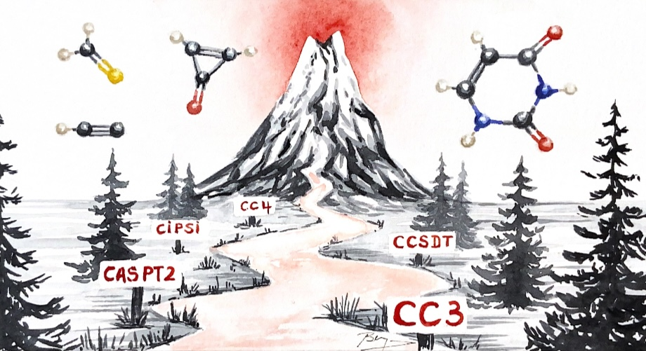
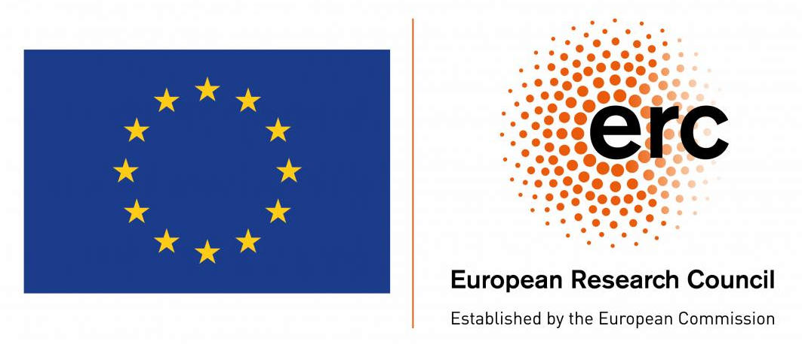

# 🚀 QUESTDB: A Database of Highly-Accurate Excitation Energies

**[Open the QUESTDB website](https://pfloos.github.io/QUESTDB/)** to search by name or formula, inspect reference energies and molecular spectra, benchmark methods, and download geometries and ready-to-run benchmark packs. The site is rebuilt from the database after pushes to `main`.

---

## 📚 Table of Contents

- [✨ Key Features](#-key-features)
- [🧪 Why Use QUESTDB?](#-why-use-questdb)
- [📂 Repository Contents](#-repository-contents)
- [⚡ Charged Excitations (charged/)](charged/README.md)
  - [valence_IPs](charged/valence_IPs/)
  - [DIPs](charged/DIPs/)
  - [core_IPs](charged/core_IPs/)
- [👥 Contributors](#-contributors)
- [📚 Main References](#-main-references)
- [Excitation energies and benchmarks](#excitation-energies-and-benchmarks)
- [Spectroscopic properties](#spectroscopic-properties)
- [🔋 Extension to Charged Excitations](#-extension-to-charged-excitations)
- [🗂️ Data Structure](#️-data-structure)
- [💰 Funding](#-funding)
- [🧮 HPC resources](#-hpc-resources)

---

## ✨ Key Features

- **🔬 High Accuracy:**  
  Data obtained using state-of-the-art methods (FCI, CC3, CCSDT, CCSDTQ, CC4, CASPT2/3, NEVPT2, etc.)

- **🌍 Wide Chemical Coverage:**  
  Includes small molecules, radicals, charged species, and transition metal complexes.

- **🎯 Challenging Excitations:**  
  Focus on **double excitations** and **intramolecular charge-transfer (CT) states**.

- **🛠️ Continuously Updated:**  
  Regularly improved with new high-level calculations and critical assessments.

- **📂 Easy-to-Use Format:**  
  Organized `.xlsx` spreadsheets and `.json` files for simple extraction and analysis.

---

## 🧪 Why Use QUESTDB?

QUESTDB supports researchers to:
- **Benchmark** TD-DFT, wavefunction-based, and emerging excited-state methods.
- **Guide** the development of new computational models.
- **Facilitate** interpretation of experimental spectra and photochemistry.

> **Note:** Our vision is to establish QUESTDB as a cornerstone resource for benchmarking and training the next generation of AI-driven models in excited-state science.

---

## ⚙️ Scripts for Subset Generation and Analysis

This repository includes Python scripts to help users generate representative *"diet"* subsets of QUEST excitation energies—for instance, sets of 50, 100, or 200 transitions that reproduce the s[...]

These tools are especially useful for benchmarking new methods quickly or for training machine learning models when computational cost is a limiting factor.

**Main functionalities include:**

- ✅ Generation of optimized subsets matching the full dataset’s distribution across:
  - Spin states
  - Valence vs Rydberg states  
  - Excitation types (e.g., nπ*, ππ*, etc.)  
  - Molecule sizes or other custom filters  
- ✅ Support for flexible user-defined filters (e.g., only valence, only singlets, exclude genuine doubles)  
- ✅ Preservation of full metadata in output JSON files  
- ✅ Optional optimization of subset selection using a genetic algorithm with Bayesian hyperparameter tuning (via [`optuna`](https://optuna.org/))  

---

## 📂 Repository Contents

This repository provides:
- **Molecular Structures**
- **Vertical Excitation Energies**
- **Oscillator Strengths**
- **Many Other Properties**
- **Charged Excitations:** High-quality datasets for ionization potentials (IPs), valence double ionization potentials (DIPs), and core ionization potentials — see the `charged/` directory for details and per-molecule JSON files (`charged/README.md`).

📌 **See the accompanying paper:**  
[**The QUEST database of highly-accurate excitation energies**](https://arxiv.org/abs/2506.11590)  
P.-F. Loos, M. Boggio-Pasqua, A. Blondel, F. Lipparini, and D. Jacquemin,  
*J. Chem. Theory Comput.* **21**, 8010 (2025). [DOI:10.1021/acs.jctc.5c00975](https://doi.org/10.1021/acs.jctc.5c00975)

<figcaption>
  Artwork by <a href="https://www.instagram.com/bea_quarelle/">Béatrice Lejeune</a>
</figcaption>

---

## 👥 Contributors

### Main contributors

- [Denis Jacquemin](https://www.univ-nantes.fr/denis-jacquemin-1) (Nantes)
- [Pierre-François Loos](https://pfloos.github.io/WEB_LOOS) (Toulouse)

### Other contributors

- [Xavier Blase](https://perso.neel.cnrs.fr/xavier.blase/) (Institut Néel, Grenoble)
- [Aymeric Blondel](https://www.univ-nantes.fr/aymeric-blondel) ( Nantes)
- [Martial Boggio-Pasqua](https://www.lcpq.ups-tlse.fr/spip.php?rubrique313&lang=fr) (Toulouse)
- [Loris Burth](https://github.com/lburth) (Toulouse)
- [Yann Damour](https://ydrnan.github.io/damour) (Toulouse)
- [Ivan Duchemin](https://irig.cea.fr/drf/irig/Pages/Animation-scientifique/HDR/2025-Duchemin.aspx) (CEA, Grenoble)
- Iryna Knysh (Nantes)
- [Fábris Kossoski](https://kossoski.github.io) (Toulouse)
- [Filippo Lipparini](https://people.unipi.it/filippo_lipparini) (Pisa)
- [Antoine Marie](https://antoine-marie.github.io) (Toulouse)
- [Devin Matthews](https://www.smu.edu/dedman/academics/departments/chemistry/people/faculty/devinmatthews) (SMU)
- Rudraditya Sarkar (Nantes)
- [Anthony Scemama](https://scemama.github.io) (Toulouse)
- [Mickael Véril](https://mveril.github.io) (Toulouse)

---

## 📚 Main References

Overview articles on the QUEST database.

- [**The QUEST database of highly-accurate excitation energies**](https://doi.org/10.1021/acs.jctc.5c00975)
  P.-F. Loos, M. Boggio-Pasqua, A. Blondel, F. Lipparini, and D. Jacquemin,
  *J. Chem. Theory Comput.* **21**, 8010 (2025).

- [**QUESTDB: a database of highly-accurate excitation energies for the electronic structure community**](https://doi.org/10.1002/wcms.1517)
  M. Véril, A. Scemama, M. Caffarel, F. Lipparini, M. Boggio-Pasqua, D. Jacquemin, and P.-F. Loos,
  *WIREs Comput. Mol. Sci.* **11**, e1517 (2021).

- [**The quest for highly accurate excitation energies: a computational perspective**](https://dx.doi.org/10.1021/acs.jpclett.0c00014)
  P.-F. Loos, A. Scemama, and D. Jacquemin,
  *J. Phys. Chem. Lett.* **11**, 2374 (2020).

### Excitation energies and benchmarks

- [**A Mountaineering Strategy to Excited States: Highly Accurate Reference Energies and Benchmarks**](https://doi.org/10.1021/acs.jctc.8b00406)
  P.-F. Loos, A. Scemama, A. Blondel, Y. Garniron, M. Caffarel, and D. Jacquemin, *J. Chem. Theory Comput.* **14**, 4360–4379 (2018).

- [**Reference Energies for Double Excitations**](https://doi.org/10.1021/acs.jctc.8b01205)
  P.-F. Loos, M. Boggio-Pasqua, A. Scemama, M. Caffarel, and D. Jacquemin, *J. Chem. Theory Comput.* **15**, 1939–1956 (2019).

- [**A Mountaineering Strategy to Excited States: Highly Accurate Energies and Benchmarks for Medium Sized Molecules**](https://doi.org/10.1021/acs.jctc.9b01216)
  P.-F. Loos, F. Lipparini, M. Boggio-Pasqua, A. Scemama, and D. Jacquemin, *J. Chem. Theory Comput.* **16**, 1711–1741 (2020).

- [**Is ADC(3) as Accurate as CC3 for Valence and Rydberg Transition Energies?**](https://doi.org/10.1021/acs.jpclett.9b03652)
  P.-F. Loos and D. Jacquemin, *J. Phys. Chem. Lett.* **11**, 974–980 (2020).

- [**Mountaineering Strategy to Excited States: Highly Accurate Energies and Benchmarks for Exotic Molecules and Radicals**](https://doi.org/10.1021/acs.jctc.0c00227)
  P.-F. Loos, A. Scemama, M. Boggio-Pasqua, and D. Jacquemin, *J. Chem. Theory Comput.* **16**, 3720–3736 (2020).

- [**Reference Energies for Intramolecular Charge-Transfer Excitations**](https://doi.org/10.1021/acs.jctc.1c00226)
  P.-F. Loos, M. Comin, X. Blase, and D. Jacquemin, *J. Chem. Theory Comput.* **17**, 3666–3686 (2021).

- [**A Mountaineering Strategy to Excited States: Highly Accurate Energies and Benchmarks for Bicyclic Systems**](https://doi.org/10.1021/acs.jpca.1c08524)
  P.-F. Loos and D. Jacquemin, *J. Phys. Chem. A* **125**, 10174–10188 (2021).

- [**How Accurate Are EOM-CC4 Vertical Excitation Energies?**](https://doi.org/10.1063/5.0055994)
  P.-F. Loos, D. A. Matthews, F. Lipparini, and D. Jacquemin, *J. Chem. Phys.* **154**, 221103 (2021).

- [**A Mountaineering Strategy to Excited States: Revising Reference Values with EOM-CC4**](https://doi.org/10.1021/acs.jctc.2c00416)
  P.-F. Loos, F. Lipparini, D. A. Matthews, A. Blondel, and D. Jacquemin, *J. Chem. Theory Comput.* **18**, 4418–4427 (2022).

- [**Assessing the Performances of CASPT2 and NEVPT2 for Vertical Excitation Energies**](https://doi.org/10.1021/acs.jctc.1c01197)
  R. Sarkar, P.-F. Loos, M. Boggio-Pasqua, and D. Jacquemin, *J. Chem. Theory Comput.* **18**, 2418–2436 (2022).

- [**Benchmarking CASPT3 Vertical Excitation Energies**](https://doi.org/10.1063/5.0095887)
  M. Boggio-Pasqua, D. Jacquemin, and P.-F. Loos, *J. Chem. Phys.* **157**, 014103 (2022).

- [**Heptazine, Cyclazine, and Related Compounds: Chemically Accurate Estimates of the Inverted Singlet–Triplet Gap**](https://doi.org/10.1021/acs.jpclett.3c03042)
  P.-F. Loos, F. Lipparini, and D. Jacquemin, *J. Phys. Chem. Lett.* **14**, 11069–11075 (2023). [Published correction](https://doi.org/10.1021/acs.jpclett.5c00462).

- [**Reference Vertical Excitation Energies for Transition Metal Compounds**](https://doi.org/10.1021/acs.jctc.3c01080)
  D. Jacquemin, F. Kossoski, F. Gam, M. Boggio-Pasqua, and P.-F. Loos, *J. Chem. Theory Comput.* **19**, 8782–8800 (2023).

- [**A Mountaineering Strategy to Excited States: Accurate Vertical Transition Energies and Benchmarks for Substituted Benzenes**](https://doi.org/10.1002/jcc.27358)
  P.-F. Loos and D. Jacquemin, *J. Comput. Chem.* **45**, 1791–1805 (2024).

- [**Reference Energies for Double Excitations: Improvement and Extension**](https://doi.org/10.1021/acs.jctc.4c00410)
  F. Kossoski, M. Boggio-Pasqua, P.-F. Loos, and D. Jacquemin, *J. Chem. Theory Comput.* **20**, 5655–5678 (2024).

- [**Reference CC3 Excitation Energies for Organic Chromophores: Benchmarking TD-DFT, BSE/GW, and Wave Function Methods**](https://doi.org/10.1021/acs.jctc.4c00906)
  I. Knysh, F. Lipparini, A. Blondel, I. Duchemin, X. Blase, P.-F. Loos, and D. Jacquemin, *J. Chem. Theory Comput.* **20**, 8152–8174 (2024).

### Spectroscopic properties

- [**A Mountaineering Strategy to Excited States: Highly Accurate Oscillator Strengths and Dipole Moments of Small Molecules**](https://doi.org/10.1021/acs.jctc.0c01111)
  A. Chrayteh, A. Blondel, P.-F. Loos, and D. Jacquemin, *J. Chem. Theory Comput.* **17**, 416–438 (2021).

- [**Benchmarking TD-DFT and Wave Function Methods for Oscillator Strengths and Excited-State Dipole Moments**](https://doi.org/10.1021/acs.jctc.0c01228)
  R. Sarkar, M. Boggio-Pasqua, P.-F. Loos, and D. Jacquemin, *J. Chem. Theory Comput.* **17**, 1117–1132 (2021).

- [**Two-Photon Absorption Strengths of Small Molecules: Reference CC3 Values and Benchmarks**](https://doi.org/10.1021/acs.jctc.4c01090)
  C. Naim, R. Zaleśny, and D. Jacquemin, *J. Chem. Theory Comput.* **20**, 9093–9106 (2024). [Published correction](https://doi.org/10.1021/acs.jctc.6c01763).

- [**Excited-State Absorption: Reference Oscillator Strengths, Wave Function, and TDDFT Benchmarks**](https://doi.org/10.1021/acs.jctc.5c00159)
  J. Širůček, B. Le Guennic, Y. Damour, P.-F. Loos, and D. Jacquemin, *J. Chem. Theory Comput.* **21**, 4688–4703 (2025).

---

## 🔋 Extension to Charged Excitations

The QUEST database also contains charged excitations, mainly ionization potentials (IPs) at the moment.
Here is the short description of the **charged** excited states included in QUEST (see the `charged` directory):

- Inner- and Outer-Valence IPs and Satellite Transitions:  
[**Reference energies for valence ionizations and satellite transitions**](https://doi.org/10.1021/acs.jctc.4c00216)  
A. Marie and P.-F. Loos,  
*J. Chem. Theory Comput.* **20**, 4751 (2024).

- Valence Double IPs (DIPs) and Double Core Holes (DCHs):  
[**Anomalous propagators and the particle-particle channel: Bethe-Salpeter equation**](https://doi.org/10.1063/5.0250155)  
A. Marie, P. Romaniello, X. Blase, and P.-F. Loos,  
*J. Chem. Phys.* **162**, 134105 (2025).

- Core IPs:  
[**Reference energies for non-relativistic core ionization potentials**](https://doi.org/10.1021/acs.jctc.6c00713)  
A. Marie, L. Burth, and P.-F. Loos,  
*J. Chem. Theory Comput.* **22**, 6609 (2026).

---

## 🗂️ Data Structure

- **Molecular Structures:**  
  `.xyz` or `.TeX` formats

- **Excitation Energies, Oscillator Strengths and Other Properties:**  
  `.xls` spreadsheets and `.json` files

- **Scripts to Convert and Analyze Data**  
  `.py` scripts to convert data from one format to another and analyze them.

- **Additional Metadata:**  
  *(Planned for future releases)*

---

## 💰 Funding

  

This database is supported by the **[PTEROSOR project](https://lcpq.github.io/PTEROSOR/)**, funded by the **[European Research Council (ERC)](https://erc.europa.eu/)** under the **EU Horizon 2020** research and innovation programme.

  

This database is also funded, in part, by the [Agence Nationale de la Recherche (ANR)](https://anr.fr/en/), grant [ANR-25-CE29-4996](https://anr.fr/Projet-ANR-25-CE29-4996).

  

QUESTDB acknowledges support from the [Institut universitaire de France (IUF)](https://www.iufrance.fr/).

---

## 🧮 HPC resources

This work was performed using HPC resources from [**CALMIP**](https://www.calmip.univ-toulouse.fr) (Toulouse, France) under allocations **2018-18005 through 2026-18005**, and CPU resources from [**GLiCID**](https://www.glicid.fr/) (Groupement Ligérien pour le Calcul Intensif Distribué).

